<div align="center">
  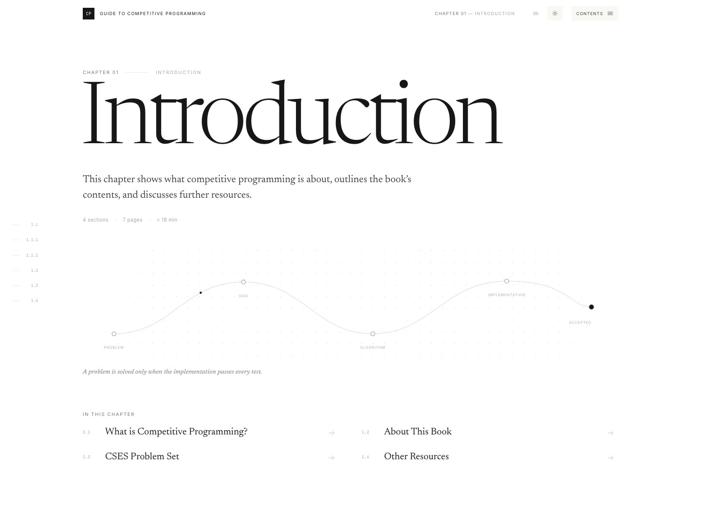
</div>

<h1 align="center">Guide to Competitive Programming</h1>

<p align="center">
  An interactive edition of Antti Laaksonen's book.<br>
  15 chapters. 145 sections. 300+ hand-built diagrams. An interaction in every chapter.
</p>

<p align="center">
  <a href="https://abhinav-prabhakar.github.io/AnttiCP/"><b>Read the book →</b></a>
</p>

<div align="center">
  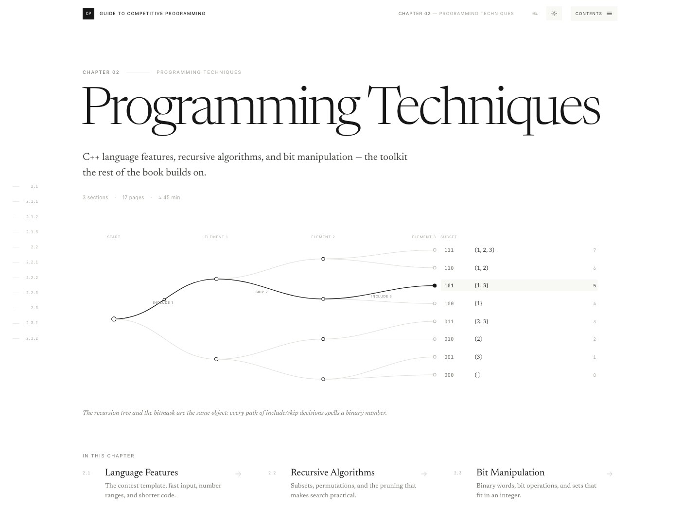
</div>

<div align="center">
  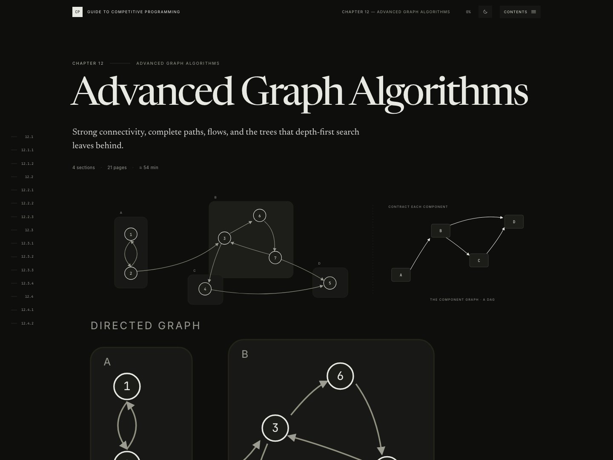
</div>

<table>
  <tr>
    <td width="50%">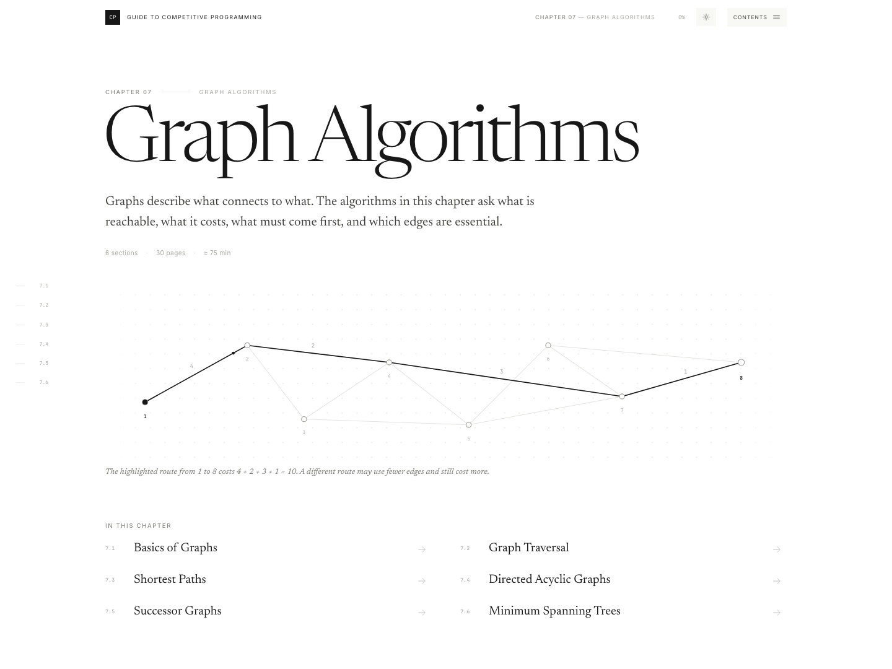</td>
    <td width="50%">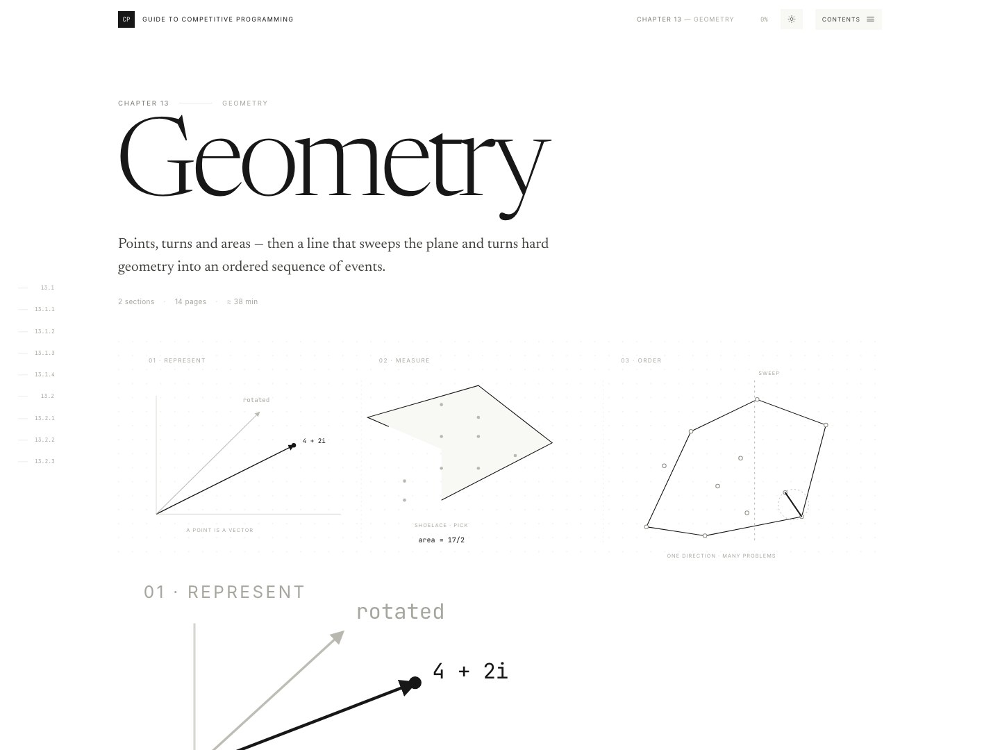</td>
  </tr>
  <tr>
    <td>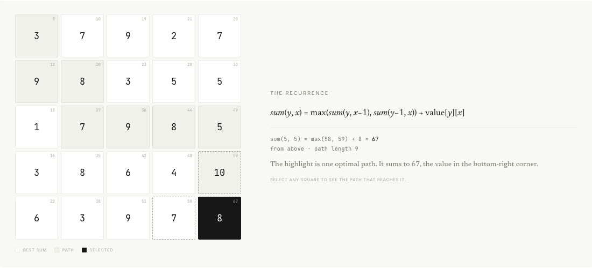</td>
    <td>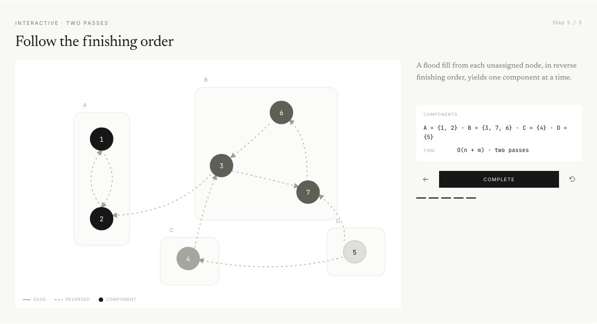</td>
  </tr>
  <tr>
    <td>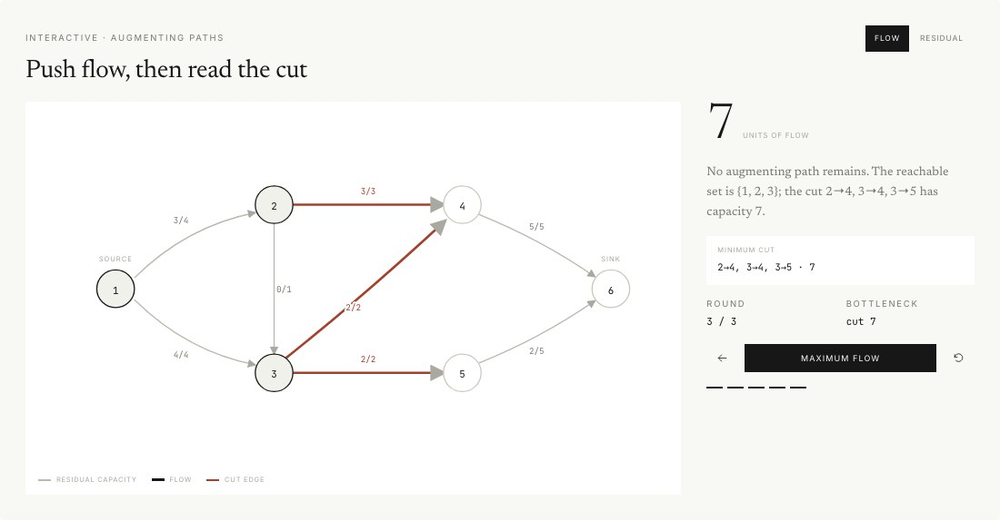</td>
    <td>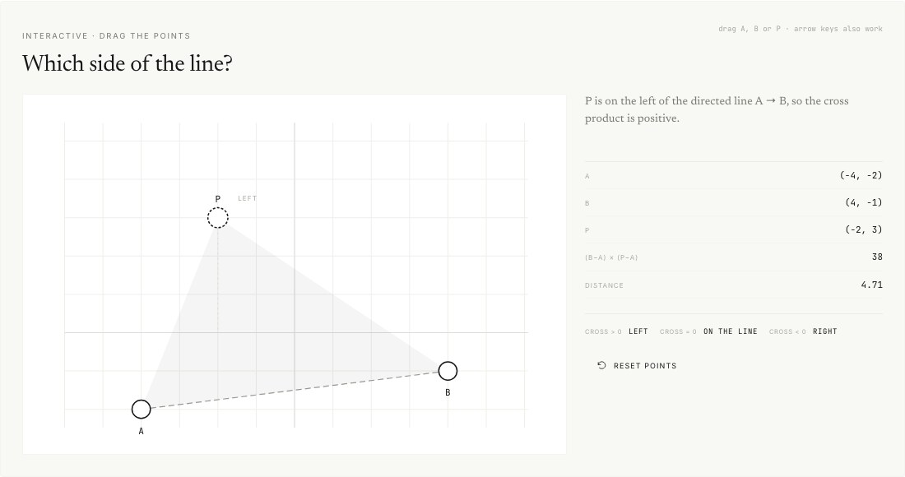</td>
  </tr>
  <tr>
    <td>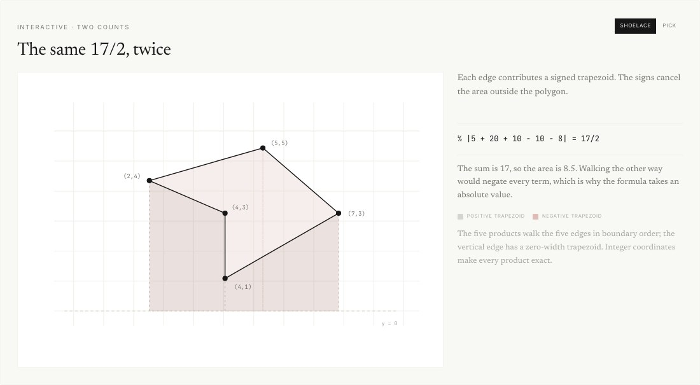</td>
    <td>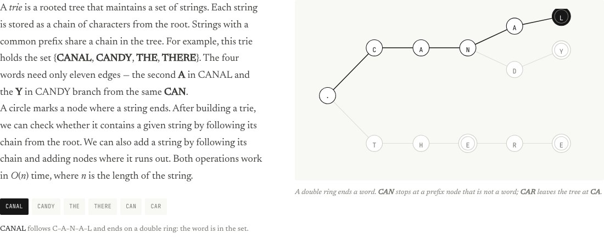</td>
  </tr>
  <tr>
    <td>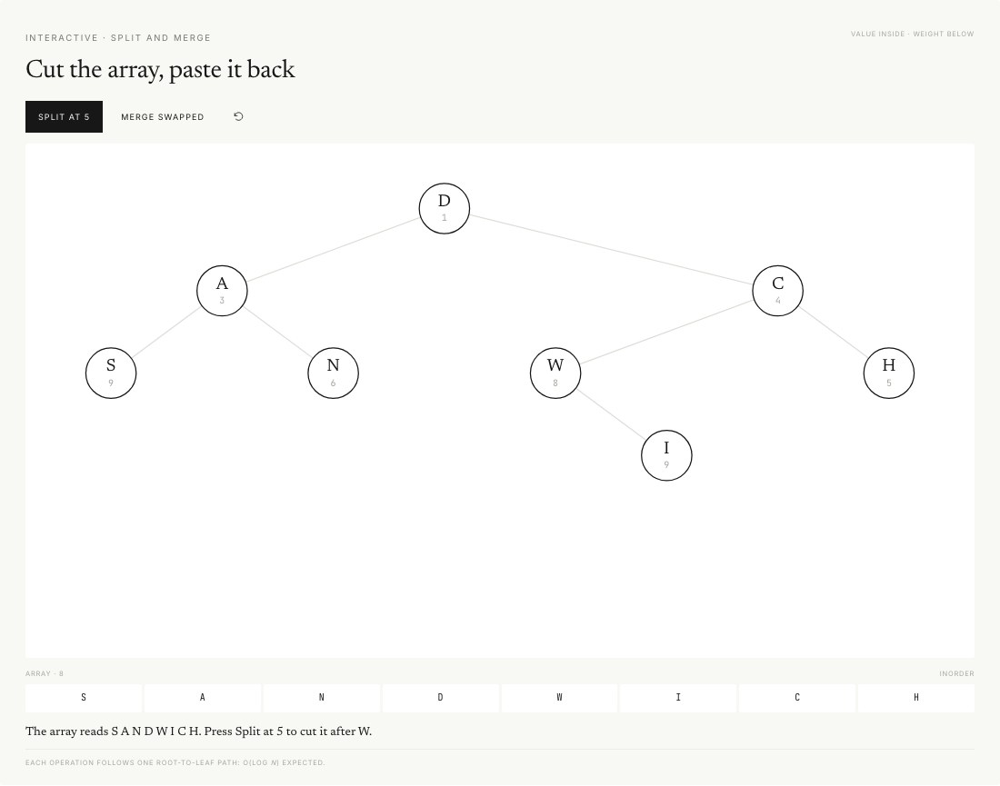</td>
    <td>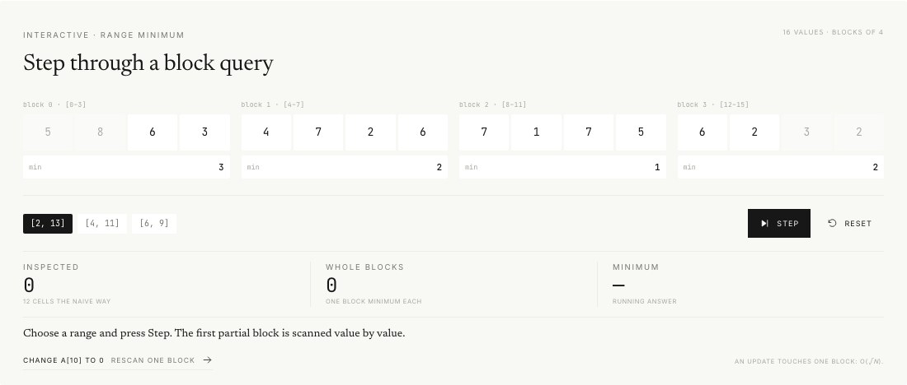</td>
  </tr>
</table>

<div align="center">
  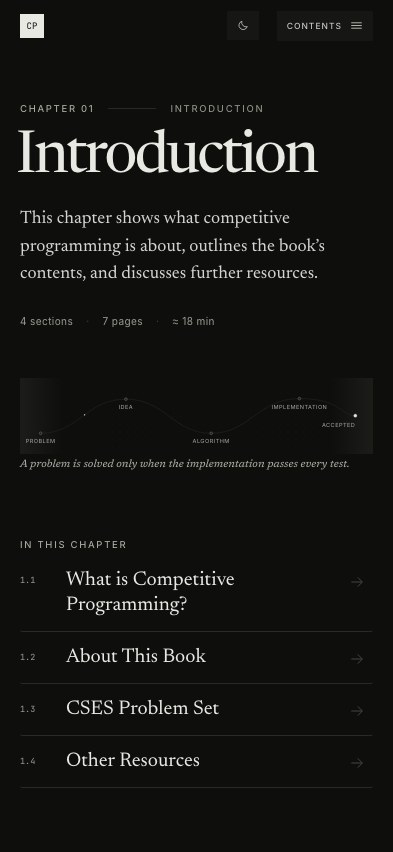
</div>

## What this is

The book's own text, set as a long-form web edition and paired with diagrams you can
read and controls you can move. Every chapter has its own visual language, but the
type, spacing and navigation stay the same from the first page to the last.

No frameworks, no external assets. The whole book is static HTML, CSS, SVG and a
little JavaScript. It follows your system theme, and the switch remembers your choice.

## Run it locally

```bash
git clone https://github.com/Abhinav-Prabhakar/AnttiCP.git
cd AnttiCP
python3 -m http.server 8123
```

Then open <http://localhost:8123/>.

## Credit

Original text and problems: *Guide to Competitive Programming* by
[Antti Laaksonen](https://www.cs.helsinki.fi/u/ahlaakso/). This is an unofficial,
non-commercial companion edition. The interactive figures, layout and code are by
[Abhinav Prabhakar](https://github.com/Abhinav-Prabhakar).
