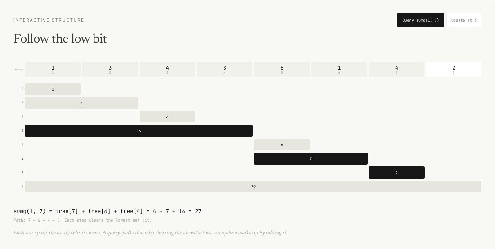
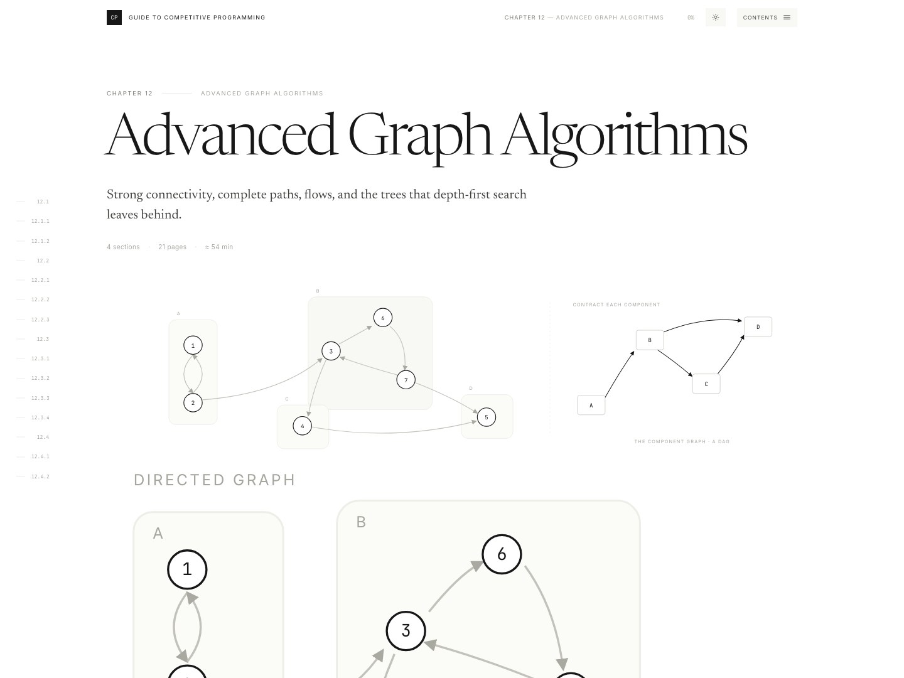

<div align="center">

<picture>
  <source media="(prefers-color-scheme: dark)" srcset="assets/readme/hero-ch01-dark.jpg">
  
</picture>

<h1>Guide to Competitive Programming</h1>

<h3>Antti Laaksonen’s book, rebuilt as a place you can read and touch.<br><sub>Fifteen chapters · 145 sections · 300+ hand-built diagrams · an interaction in every chapter</sub></h3>

<p>
  
  
  
  
  
  
  
  
  
</p>

<p>
  <a href="https://abhinav-prabhakar.github.io/AnttiCP/"></a>
</p>

<p>
  <a href="#the-book"><b>The book</b></a> &nbsp;·&nbsp;
  <a href="#things-you-can-move"><b>Interactives</b></a> &nbsp;·&nbsp;
  <a href="#light-and-dark"><b>Light &amp; dark</b></a> &nbsp;·&nbsp;
  <a href="#fifteen-chapters"><b>Chapters</b></a> &nbsp;·&nbsp;
  <a href="#run-it-locally"><b>Run it</b></a> &nbsp;·&nbsp;
  <a href="#credit"><b>Credit</b></a>
</p>

</div>

<br>

The book’s own text, set as a long-form web edition and paired with diagrams you can read and controls you can move. Every chapter has its own visual language, but the type, spacing and navigation stay the same from the first page to the last.

> [!NOTE]
> This is an unofficial, non-commercial companion edition of *Guide to Competitive Programming* by **Antti Laaksonen**. The text is his; the interactive edition is by **Abhinav Prabhakar**.

<br>

## The book

<picture>
  <source media="(prefers-color-scheme: dark)" srcset="assets/readme/hero-ch02-dark.jpg">
  
</picture>

<p align="center"><sub><b>Chapter 2 · Programming Techniques.</b> A running head, a large opening statement, and a diagram that carries the chapter’s idea before the first paragraph does.</sub></p>

Each chapter opens on a title spread, then settles into a reading column: numbered sections, the author’s prose, code cards that switch between C++ and Python, and figures built for the web rather than scanned from a page.

<table>
  <tr>
    <td width="50%" valign="top">
      <a href="https://abhinav-prabhakar.github.io/AnttiCP/ch07.html">
        <picture>
          <source media="(prefers-color-scheme: dark)" srcset="assets/readme/hero-ch07-dark.jpg">
          
        </picture>
      </a>
      <br>
      <b>07 · Graph Algorithms</b><br>
      <sub>Traversal, shortest paths and spanning trees, drawn as graphs you can follow.</sub>
    </td>
    <td width="50%" valign="top">
      <a href="https://abhinav-prabhakar.github.io/AnttiCP/ch13.html">
        <picture>
          <source media="(prefers-color-scheme: dark)" srcset="assets/readme/hero-ch13-dark.jpg">
          
        </picture>
      </a>
      <br>
      <b>13 · Geometry</b><br>
      <sub>Points, vectors and polygons, with every construction available to drag.</sub>
    </td>
  </tr>
</table>

<br>

## Things you can move

<p align="center"><sub>Not screenshots of diagrams. Diagrams that answer back.</sub></p>

<table>
  <tr>
    <td width="50%" valign="top">
      <picture>
        <source media="(prefers-color-scheme: dark)" srcset="assets/readme/dp-grid-dark.jpg">
        
      </picture>
      <br>
      <b>06 · Dynamic programming</b><br>
      <sub>Click a square and watch its value resolve from the two neighbours it depends on.</sub>
    </td>
    <td width="50%" valign="top">
      <picture>
        <source media="(prefers-color-scheme: dark)" srcset="assets/readme/fenwick-dark.jpg">
        
      </picture>
      <br>
      <b>09 · Range queries</b><br>
      <sub>Pick a range and the tree answers with a few bars instead of every value.</sub>
    </td>
  </tr>
  <tr>
    <td width="50%" valign="top">
      <picture>
        <source media="(prefers-color-scheme: dark)" srcset="assets/readme/max-flow-dark.jpg">
        
      </picture>
      <br>
      <b>12 · Flow and cuts</b><br>
      <sub>Push flow until the cut appears, then read the same number off both sides.</sub>
    </td>
    <td width="50%" valign="top">
      <picture>
        <source media="(prefers-color-scheme: dark)" srcset="assets/readme/orientation-dark.jpg">
        
      </picture>
      <br>
      <b>13 · Orientation</b><br>
      <sub>Drag a point; the cross product decides the turn before the line settles.</sub>
    </td>
  </tr>
  <tr>
    <td width="50%" valign="top">
      <picture>
        <source media="(prefers-color-scheme: dark)" srcset="assets/readme/kosaraju-dark.jpg">
        
      </picture>
      <br>
      <b>12 · Strong connectivity</b><br>
      <sub>Step Kosaraju’s algorithm and watch the components contract into a DAG.</sub>
    </td>
    <td width="50%" valign="top">
      <picture>
        <source media="(prefers-color-scheme: dark)" srcset="assets/readme/polygon-area-dark.jpg">
        
      </picture>
      <br>
      <b>13 · Two counts, one area</b><br>
      <sub>Shoelace and Pick’s theorem, computing the same polygon side by side.</sub>
    </td>
  </tr>
  <tr>
    <td width="50%" valign="top">
      <picture>
        <source media="(prefers-color-scheme: dark)" srcset="assets/readme/trie-dark.jpg">
        
      </picture>
      <br>
      <b>14 · Tries</b><br>
      <sub>Type a prefix and follow it down the tree, one character per step.</sub>
    </td>
    <td width="50%" valign="top">
      <picture>
        <source media="(prefers-color-scheme: dark)" srcset="assets/readme/sqrt-blocks-dark.jpg">
        
      </picture>
      <br>
      <b>15 · Square root decomposition</b><br>
      <sub>Move the query and watch whole blocks answer instead of every element.</sub>
    </td>
  </tr>
</table>

<picture>
  <source media="(prefers-color-scheme: dark)" srcset="assets/readme/treap-dark.jpg">
  
</picture>

<p align="center"><sub><b>15 · Treaps.</b> Split at 5 and merge the halves; the priorities keep the tree balanced without being asked.</sub></p>

<br>

## Light and dark

<table>
  <tr>
    <td width="50%" valign="top">
      
      <br>
      <sub><b>Light</b> · ink on paper, hairline rules, warm neutrals.</sub>
    </td>
    <td width="50%" valign="top">
      
      <br>
      <sub><b>Dark</b> · the same page at night, with the diagrams retuned, not just dimmed.</sub>
    </td>
  </tr>
  <tr>
    <td width="50%" valign="top">
      
      <br>
      <sub><b>Phone</b> · one column, larger type, the same navigation.</sub>
    </td>
    <td width="50%" valign="top">
      
      <br>
      <sub><b>And back</b> · follows your system until you choose; the switch remembers.</sub>
    </td>
  </tr>
</table>

<br>

The theme follows `prefers-color-scheme` on first visit. Pick light or dark and the choice is stored, so the next chapter opens the same way. Diagrams, code tokens, hairlines and shadows all have dark values, and the type gets a little heavier so it holds up against the dark ground.

<br>

## Fifteen chapters

<table>
  <tr>
    <td width="33%"><a href="https://abhinav-prabhakar.github.io/AnttiCP/"><b>01</b> · Introduction</a></td>
    <td width="33%"><a href="https://abhinav-prabhakar.github.io/AnttiCP/ch06.html"><b>06</b> · Dynamic Programming</a></td>
    <td width="33%"><a href="https://abhinav-prabhakar.github.io/AnttiCP/ch11.html"><b>11</b> · Mathematics</a></td>
  </tr>
  <tr>
    <td><a href="https://abhinav-prabhakar.github.io/AnttiCP/ch02.html"><b>02</b> · Programming Techniques</a></td>
    <td><a href="https://abhinav-prabhakar.github.io/AnttiCP/ch07.html"><b>07</b> · Graph Algorithms</a></td>
    <td><a href="https://abhinav-prabhakar.github.io/AnttiCP/ch12.html"><b>12</b> · Advanced Graph Algorithms</a></td>
  </tr>
  <tr>
    <td><a href="https://abhinav-prabhakar.github.io/AnttiCP/ch03.html"><b>03</b> · Efficiency</a></td>
    <td><a href="https://abhinav-prabhakar.github.io/AnttiCP/ch08.html"><b>08</b> · Algorithm Design Topics</a></td>
    <td><a href="https://abhinav-prabhakar.github.io/AnttiCP/ch13.html"><b>13</b> · Geometry</a></td>
  </tr>
  <tr>
    <td><a href="https://abhinav-prabhakar.github.io/AnttiCP/ch04.html"><b>04</b> · Sorting and Searching</a></td>
    <td><a href="https://abhinav-prabhakar.github.io/AnttiCP/ch09.html"><b>09</b> · Range Queries</a></td>
    <td><a href="https://abhinav-prabhakar.github.io/AnttiCP/ch14.html"><b>14</b> · String Algorithms</a></td>
  </tr>
  <tr>
    <td><a href="https://abhinav-prabhakar.github.io/AnttiCP/ch05.html"><b>05</b> · Data Structures</a></td>
    <td><a href="https://abhinav-prabhakar.github.io/AnttiCP/ch10.html"><b>10</b> · Tree Algorithms</a></td>
    <td><a href="https://abhinav-prabhakar.github.io/AnttiCP/ch15.html"><b>15</b> · Additional Topics</a></td>
  </tr>
</table>

<details>
<summary><b>What’s inside the edition</b></summary>
<br>

| | |
|:--|:--|
| Chapters | 15, each with its own visual language |
| Sections | 145, numbered and linked from a side rail |
| Diagrams | 335 inline SVGs, many of them interactive |
| Code | 30 cards with C++ and Python tabs |
| Theme | Light and dark, following the system, with a remembered override |
| Runtime | Static HTML, CSS, SVG and a little JavaScript |
| Dependencies | None |
| Hosting | GitHub Pages, straight from `main` |

</details>

<br>

## Run it locally

```bash
git clone https://github.com/Abhinav-Prabhakar/AnttiCP.git
cd AnttiCP
python3 -m http.server 8123
```

Then open <http://localhost:8123/>. The checked-in HTML is the site; `node build.mjs` regenerates it from `chapters/*.body.html` if you change the prose.

<br>

## Credit

> [!NOTE]
> Original text and problems: *Guide to Competitive Programming* by
> [Antti Laaksonen](https://www.cs.helsinki.fi/u/ahlaakso/). This is an unofficial,
> non-commercial companion edition. The interactive figures, layout and code are by
> [Abhinav Prabhakar](https://github.com/Abhinav-Prabhakar).

<br>

<div align="center">
  <sub>Set in Newsreader, Inter and JetBrains Mono.<br>Built with HTML, CSS, SVG and a little JavaScript.</sub>
</div>
